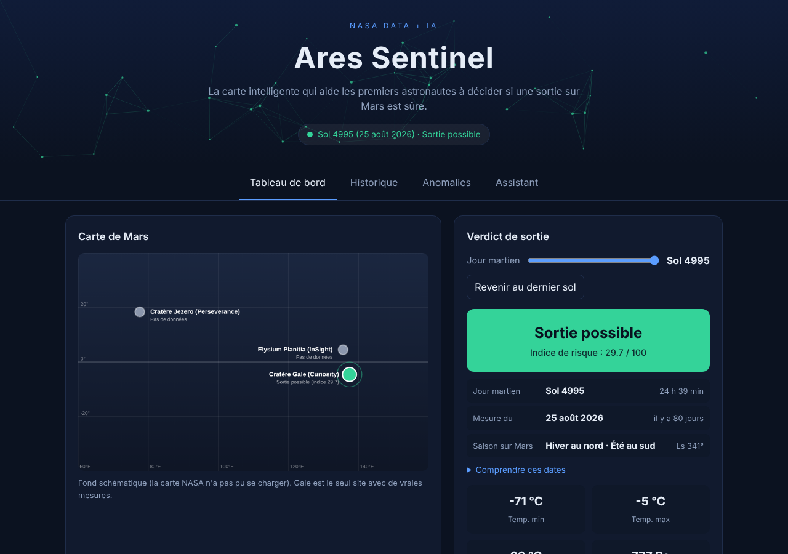
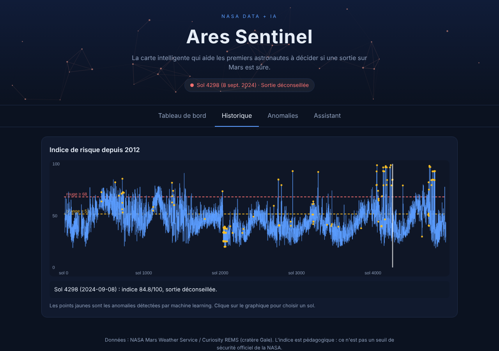
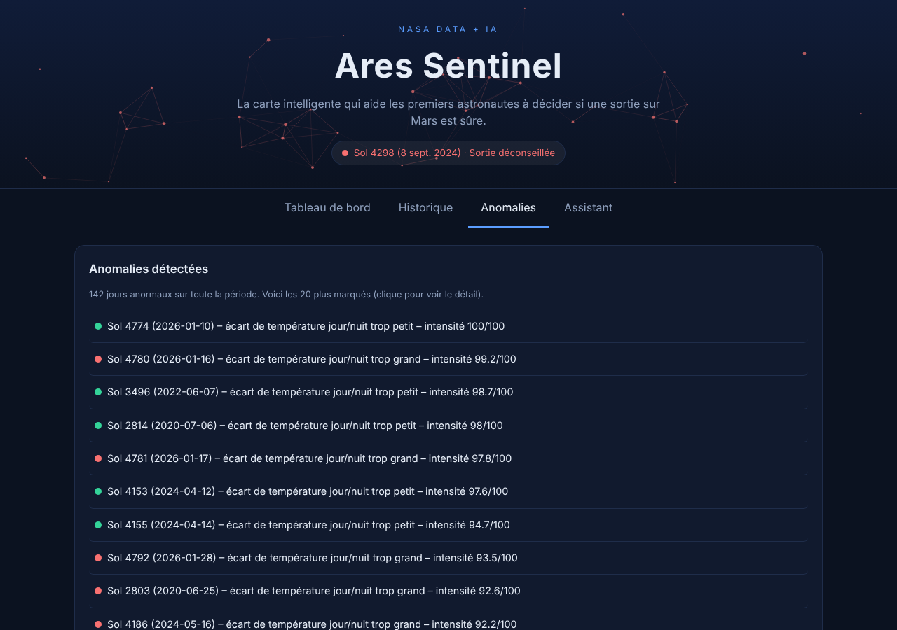
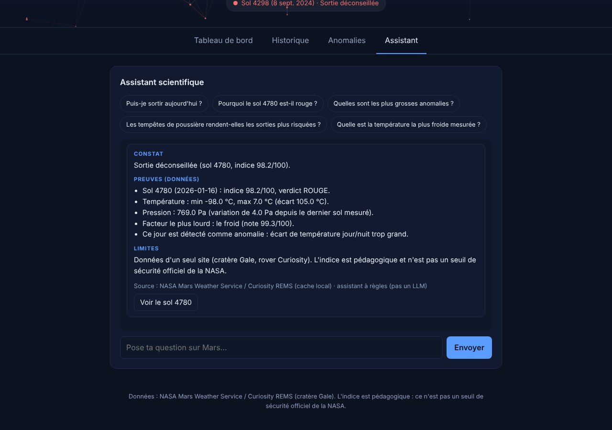
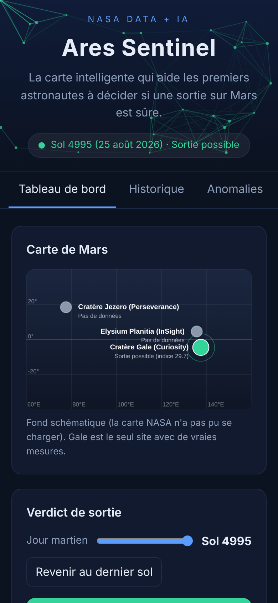
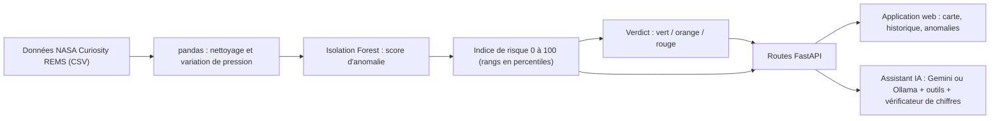

# 🛡️ Ares Sentinel

**La carte intelligente qui aide les premiers astronautes à décider si une sortie sur Mars est sûre.**

Une plateforme d'analyse scientifique **NASA Data + IA** pour l'exploration de Mars : cartographie interactive avec de vraies images de la NASA, détection d'anomalies par apprentissage automatique, et un assistant scientifique IA qui n'invente jamais un chiffre.

    

🇬🇧 **[English version → README.md](README.md)**

> *Ares* est le nom grec du dieu associé à Mars. *Sentinel* évoque une vigie qui veille et donne l'alerte. Ensemble : un gardien qui veille sur les premiers explorateurs de Mars.

> ⚠️ **Projet éducatif.** Ce n'est pas un produit de la NASA, il n'est pas approuvé par la NASA, et il **ne doit pas servir à de vraies décisions de mission ou de sécurité**. Voir les [Limites](#-limites-et-honnêteté).

---

## 🎬 Démo

| | |
|---|---|
| 🌐 **Démo en ligne** | https://ares-sentinel.onrender.com *(à remplacer par ton adresse Render une fois déployé)* |
| 🎥 **Vidéo** | https://www.youtube.com/watch?v=ID_DE_TA_VIDEO *(à remplacer par le lien de ta vidéo)* |
| 💻 **Code source** | https://github.com/TON-PSEUDO/ares-sentinel *(à remplacer)* |

### Captures d'écran

**Tableau de bord** : carte, verdict, dates et les quatre facteurs de la décision


**Historique** : l'indice de risque de chaque jour martien depuis 2012 (points jaunes = anomalies trouvées par machine learning)


**Anomalies** : les jours que le modèle juge inhabituels, avec la raison


**Assistant IA** : réponses en *Constat → Preuves → Limites*, uniquement à partir de vraies données


**Mobile**


> 📸 *La capture du tableau de bord ci-dessus peut montrer la carte dessinée simple. Avec internet, l'application affiche les vraies images de la NASA (Mars Trek) : refais la capture depuis ton navigateur et remplace `docs/screenshots/dashboard.png`.*

### Photos et liens NASA pour voir la réalité
- 🛰️ La station météo de Curiosity (REMS) sur son mât : https://science.nasa.gov/resource/mars-weather-station-tools-on-rovers-mast/
- 📈 Cycles saisonniers de température, d'humidité et de pression mesurés par Curiosity : https://science.nasa.gov/photojournal/seasonal-cycles-in-curiositys-first-two-martian-years/
- 🇪🇸 L'équipe REMS (Centro de Astrobiología, Espagne) : https://cab.inta-csic.es/en/proyectos/msl-rems/
- 🗺️ NASA Mars Trek (les images de la carte) : https://trek.nasa.gov/mars/
- 🌍 La mosaïque globale Viking de Mars (USGS) : https://astrogeology.usgs.gov/search/map/mars_viking_colorized_global_mosaic_232m
- 🚀 Page de la mission Curiosity : https://science.nasa.gov/mission/msl-curiosity/

---

## 📑 Sommaire

1. [Le problème](#-le-problème)
2. [Ce que fait Ares Sentinel](#-ce-que-fait-ares-sentinel)
3. [Mars expliquée simplement](#-mars-expliquée-simplement)
4. [Le rover Curiosity et l'atterrissage de 2012](#-le-rover-curiosity-et-latterrissage-de-2012)
5. [Les données](#-les-données)
6. [Comment ça marche](#-comment-ça-marche)
7. [Structure du projet et API](#-structure-du-projet-et-api)
8. [Démarrer](#-démarrer)
9. [Déployer sur Render](#-déployer-sur-render)
10. [Sécurité : garder les secrets hors de GitHub](#-sécurité--garder-les-secrets-hors-de-github)
11. [Limites et honnêteté](#-limites-et-honnêteté)
12. [Pistes d'évolution](#-pistes-dévolution)
13. [Crédits](#-crédits)

---

## 🎯 Le problème

Mars n'est pas un endroit où l'on sort simplement faire un tour. Avant qu'un astronaute quitte la base, quelqu'un doit répondre à une question : **« Aujourd'hui, est-ce plus risqué que d'habitude ? »** La NASA possède des années de données météo du rover Curiosity, mais des chiffres bruts (températures en degrés, pression en pascals, angles sur une orbite) sont difficiles à transformer en décision rapide.

Ares Sentinel transforme ces chiffres en **feu tricolore** et, surtout, **explique pourquoi**.

## ✨ Ce que fait Ares Sentinel

| Fonction | Ce que ça apporte |
|---|---|
| 🗺️ **Carte interactive** | De vraies images de Mars (NASA Mars Trek) avec zoom et déplacement, et les trois sites colorés selon le verdict. Une carte dessinée prend le relais si les images ne se chargent pas. |
| 🚦 **Verdict pour n'importe quel jour martien** | 🟢 Possible · 🟠 Prudence · 🔴 Déconseillée, à partir d'un indice de risque entre 0 et 100, avec un curseur pour parcourir 14 ans de données. |
| 🔍 **Décision expliquée** | Les quatre facteurs (froid, écart jour/nuit, variation de pression, jour inhabituel) en barres, chacun avec son poids. |
| 🤖 **Détection d'anomalies** | Un modèle de machine learning (Isolation Forest) marque ~3 % des jours comme inhabituels et dit quelle mesure en est la cause. |
| 💬 **Assistant scientifique IA** | Répond en *Constat → Preuves → Limites*, **uniquement à partir de données réelles**, grâce à des outils. Un vérificateur signale tout chiffre qui ne vient pas des données. Fonctionne avec Google Gemini (en ligne) ou Ollama (local), avec un secours automatique. |
| 📅 **Dates claires** | Jour martien (sol), date sur Terre, ancienneté de la mesure, et saison martienne en mots simples. |

---

## 🪐 Mars expliquée simplement

### Mars en un coup d'œil

| | Mars | Terre |
|---|---|---|
| Diamètre | environ 6 800 km | environ 12 700 km (deux fois plus grande) |
| Gravité | 3,7 m/s² (**38 %** de la nôtre) | 9,8 m/s² |
| Un jour | **24 h 39 min** (appelé *sol*) | 24 h |
| Une année | **687 jours terrestres** | 365 jours |
| Inclinaison de l'axe | 25° | 23° |
| Distance au Soleil | environ 1,5 fois celle de la Terre | 1 |
| Air | **95 % de dioxyde de carbone** | 78 % d'azote, 21 % d'oxygène |
| Pression de l'air au sol | **environ 600 Pa en moyenne** (0,6 % de celle de la Terre) | 101 325 Pa |
| Température moyenne | environ −63 °C | environ +15 °C |
| Champ magnétique global | aucun | oui |

### Le sol : un jour martien
Mars tourne un peu plus lentement que la Terre. Un jour martien, un **sol**, dure 24 heures 39 minutes. Les équipes des missions comptent les jours en sols : **le sol 0 est le jour de l'atterrissage de Curiosity** (6 août 2012). Dans ce projet, « sol 4995 » veut dire le 4 995ᵉ jour martien de la mission.

### Les saisons, et ce que veut dire « Ls »
Mars est inclinée comme la Terre, donc elle a des **saisons**. Mais son année dure 687 jours : chaque saison dure environ deux fois plus longtemps que chez nous. Deux autres différences :

- **Les saisons sont inversées entre les deux hémisphères** (hiver au nord = été au sud), exactement comme sur Terre.
- L'orbite de Mars est **plus allongée** que celle de la Terre. Quand Mars est plus près du Soleil, elle va plus vite : les saisons ont donc des **durées inégales**, et l'été du sud est plus chaud et plus court que celui du nord.

Les scientifiques repèrent la position de Mars sur son orbite avec **Ls** (*longitude solaire*), un angle de 0° à 360° :

| Ls | Hémisphère nord | Hémisphère sud |
|---|---|---|
| **0°** | Début du printemps | Début de l'automne |
| **90°** | Début de l'été | Début de l'hiver |
| **180°** | Début de l'automne | Début du printemps |
| **270°** | Début de l'hiver | Début de l'été |

Mars est au plus près du Soleil (périhélie) vers Ls 250°, et au plus loin (aphélie) vers Ls 70°. Par exemple, le dernier jour des données (sol 4995) avait Ls ≈ 341° : **fin de l'hiver au nord, fin de l'été au sud**.

### La température : pourquoi si froid, et pourquoi de si grands écarts ?
Sur Terre, une atmosphère épaisse joue le rôle d'une couverture : elle emmagasine la chaleur du Soleil et la rend lentement la nuit. Mars n'a presque pas de couverture. L'air est extrêmement fin et sec, donc :

1. **Il fait froid en moyenne** : Mars est plus loin du Soleil et reçoit moins de lumière.
2. **La chaleur s'échappe aussitôt après le coucher du Soleil** : rien ne la retient.
3. **Le jour et la nuit sont très différents** : dans nos données, l'écart entre le moment le plus froid et le plus chaud d'un même jour est de **62 °C en moyenne**, parfois plus de 100 °C.

Ce que montrent les données de Curiosity (cratère Gale) :

| Mesure | Valeur dans nos données |
|---|---|
| Minimum journalier moyen | **−74,6 °C** (−102 °F) |
| Maximum journalier moyen | **−12,2 °C** (10 °F) |
| Minimum le plus froid | **−100 °C** (−148 °F) |
| Maximum le plus chaud | **+11 °C** |

Même la partie « chaude » d'un jour martien reste donc le plus souvent sous zéro. Pour comparer, les nuits d'hiver les plus froides en Antarctique tournent autour de −60 à −80 °C.

> 🧊 **Pourquoi c'est important pour un astronaute :** une combinaison doit protéger contre un froid extrême **et** contre de grandes variations de température pendant une seule sortie (les matériaux se dilatent et se contractent, les batteries perdent de la puissance au froid). Dans Ares Sentinel, le **froid** compte pour 35 % de l'indice de risque.

### La pression : une atmosphère 120 fois plus fine que la nôtre
La pression de l'air, c'est le poids de la colonne d'air au-dessus de toi. Sur Mars, la pression moyenne au cratère Gale dans nos données est d'**environ 817 Pa** : à peu près **124 fois moins que sur Terre** (101 325 Pa). Quelques conséquences :

- **Un humain ne pourrait pas survivre dehors sans combinaison pressurisée.** En dessous d'environ 6 300 Pa (la *limite d'Armstrong*), l'eau de ton corps se mettrait à bouillir à la température du corps. Mars est très en dessous de cette limite.
- **L'eau liquide ne peut pas rester à la surface.** À 817 Pa, l'eau bout à seulement **4 °C** environ ; sinon elle gèle ou s'évapore.
- **Les vents semblent faibles.** Même un vent de 100 km/h pousse très peu, car l'air est très fin. Les tempêtes de poussière impressionnent à regarder, mais elles ne te renverseraient pas comme dans les films.

La pression **change aussi avec les saisons** : pendant l'hiver martien, une grande partie du dioxyde de carbone de l'air (environ un quart) gèle sur les calottes polaires, donc la pression baisse. En été il s'évapore et la pression remonte. S'ajoutent des changements **d'un jour à l'autre**, signe de systèmes météo qui passent, de tourbillons ou de tempêtes de poussière. C'est pourquoi Ares Sentinel regarde la **variation de pression entre deux jours** : un changement brutal signale un temps agité. Dans nos données, la pression va de **679 à 925 Pa**.

### La poussière et les tempêtes de poussière
Mars est couverte d'une poussière très fine. Au printemps et en été du sud (Ls entre environ 180° et 360°), la chaleur du Soleil la soulève et les **tempêtes de poussière régionales** sont fréquentes ; tous les quelques ans, certaines deviennent des **tempêtes globales** qui couvrent toute la planète pendant des semaines. En 2018, une tempête globale a tellement caché le Soleil que le rover Opportunity de la NASA, alimenté par des panneaux solaires, a perdu son énergie et est resté silencieux. Curiosity, alimenté par une **pile nucléaire**, a continué de fonctionner.

La poussière modifie aussi la température : elle absorbe la lumière du Soleil, donc les **jours se refroidissent** et les **nuits restent plus chaudes** ; l'écart jour/nuit diminue. C'est pourquoi, dans nos données, la saison des poussières ne paraît **pas** simplement « pire » : le résultat est mitigé (un écart plus petit, mais davantage de jours à pression instable).

Pour les astronautes, la poussière est une menace d'une autre sorte : elle est **coupante, collante et chargée d'électricité statique**. Elle encrasse les articulations, couvre les panneaux solaires et colle aux combinaisons.

### Ce qu'Ares Sentinel ne mesure *pas*
La radiation, le vent et l'humidité sont de vrais dangers sur Mars, mais ils ne font **pas** partie de l'indice de ce projet :

- **Radiation :** Mars n'a pas de champ magnétique global et son atmosphère est très fine, donc les rayonnements cosmiques et solaires atteignent le sol plus fortement que sur Terre. Curiosity embarque un instrument pour cela (RAD), mais nous ne l'utilisons pas.
- **Vent et humidité :** la station météo de Curiosity les mesure aussi (le capteur de vent a été endommagé au début de la mission), et ils ne sont pas utilisés ici non plus.

L'assistant est conçu pour dire « je n'ai pas cette donnée » plutôt que de deviner.

---

## 🚀 Le rover Curiosity et l'atterrissage de 2012

**Curiosity** (nom de la mission : *Mars Science Laboratory*, MSL) est un rover de la NASA de la taille d'une petite voiture : environ **899 kg**, six roues, un bras robotisé, un laser pour analyser les roches, et **10 instruments scientifiques**. Il est alimenté par un **générateur à radioisotope** (la chaleur du plutonium transformée en électricité), donc il continue de fonctionner la nuit, l'hiver et pendant les tempêtes de poussière.

Sa mission : savoir si Mars a déjà offert un environnement **habitable pour la vie microbienne**. Il ne cherche pas la vie elle-même ; il cherche les ingrédients.

### Dates clés
| Date | Événement |
|---|---|
| **26 nov. 2011** | Lancement depuis Cap Canaveral sur une fusée Atlas V |
| **6 août 2012, 05 h 17 UTC** | **Atterrissage** dans le cratère Gale (sol 0) |
| 22 août 2012 | Le site est nommé *Bradbury Landing* (en hommage à l'écrivain Ray Bradbury, le jour de ce qui aurait été son 92ᵉ anniversaire) |
| 2013 | Premier grand résultat : un ancien environnement de lac d'eau douce qui aurait pu accueillir des microbes (Yellowknife Bay) |
| Aujourd'hui | Il grimpe toujours le mont Sharp, plus de 14 ans plus tard : la mission était prévue pour environ deux ans |

### Pourquoi le cratère Gale ?
Gale est un cratère de **154 km de large** (âgé d'environ 3,5 à 3,8 milliards d'années) avec une montagne au centre, le **mont Sharp**, d'environ 5 km de haut. Ses **couches** sont comme les pages d'un livre d'histoire : chacune garde l'environnement de son époque (argiles, sulfates, traces d'eau). Monter la montagne, c'est lire l'histoire du climat de Mars.

### « Sept minutes de terreur » : l'atterrissage
Le signal de Mars met **13,8 minutes** pour arriver sur Terre. Quand les ingénieurs ont entendu « l'entrée dans l'atmosphère commence », le rover était **déjà détruit ou déjà posé**, et personne ne pouvait rien faire. Tout devait se dérouler seul, en environ **7 minutes**, de **21 000 km/h à zéro** :

1. **Entrée guidée.** Deux masses de tungstène (150 kg au total) ont été larguées pour que la capsule puisse « se diriger » un peu dans l'air et viser avec précision.
2. **Bouclier thermique.** Le frottement avec l'atmosphère chauffe énormément l'avant de la capsule. Le bouclier protège le rover et commence à le ralentir.
3. **Parachute supersonique.** Un parachute géant s'ouvre et ralentit encore la capsule.
4. **Bouclier largué, radar activé.** Le radar mesure la distance au sol.
5. **Descente propulsée.** Le rover et son « étage de descente » à fusées se séparent du parachute. **Huit moteurs-fusées** s'allument pour stopper la chute.
6. **La grue volante (sky crane).** C'est l'astuce célèbre. L'étage à fusées **fait du surplace** à environ 20 m du sol et **descend le rover au bout de trois câbles en nylon** (environ 7,5 m), comme une grue accrochée au ciel. Pourquoi pas des fusées directement au sol ? Elles soulèveraient de la poussière partout et pourraient abîmer le rover.
7. **Contact.** Roues d'abord, plus lentement qu'un pas de marche. Les câbles sont coupés, et l'étage à fusées **s'envole pour s'écraser à bonne distance du rover**.

**76 dispositifs pyrotechniques** devaient fonctionner parfaitement, dans l'ordre. Tous ont fonctionné. Le satellite relais *Mars Odyssey* a transmis la nouvelle à la Terre : *« Touchdown confirmed. We're safe on Mars. »* (« Contact confirmé. Nous sommes en sécurité sur Mars. ») La grue volante a servi de nouveau en 2021 pour poser le rover Perseverance.

### La station météo : REMS
Curiosity porte une station météo appelée **REMS** (*Rover Environmental Monitoring Station*), fournie par l'**Espagne** (Centro de Astrobiología) avec des capteurs de **Finlande**. Elle mesure la température de l'air et du sol, la pression, l'humidité, le vent et la lumière ultraviolette, plusieurs fois par heure. **Ce sont les mesures qu'utilise Ares Sentinel** (température et pression).

---

## 📊 Les données

- **Source :** NASA Mars Weather Service, construit à partir de l'instrument REMS de Curiosity (cratère Gale).
- **Fichier :** `data/curiosity_rems.csv`, **4 745 jours martiens** d'août 2012 au **25 août 2026** (sol 4995).
- **Important :** c'est une **copie enregistrée**, pas un flux en direct. « Aujourd'hui » dans l'application veut dire « le dernier jour de cette copie ». Pour des jours plus récents, mets le fichier à jour avec le script ci-dessous.
- **Mettre à jour les données :** depuis `backend/`, lance `uv run python scripts/update_data.py` (ajoute `--dry-run` pour simplement prévisualiser). Le script télécharge le flux JSON public « Mars Weather Service » de la NASA (`https://mars.nasa.gov/rss/api/?feed=weather&category=msl&feedtype=json`), ajoute les nouveaux jours martiens au CSV, rejette les dates invalides et les valeurs impossibles, garde une sauvegarde `.bak`, et **ne touche jamais au fichier si le téléchargement échoue**. C'est un flux non officiel que la NASA peut modifier ou arrêter ; s'il ne répond pas, ouvre l'adresse dans ton navigateur, enregistre la page sous `flux.json` et lance `uv run python scripts/update_data.py --input flux.json`. L'archive officielle est le PDS Atmospheres Node de la NASA : https://atmos.nmsu.edu/data_and_services/atmospheres_data/MARS/curiosity/rems.html (fichiers plus lourds, non gérés par le script). Redémarre ensuite le serveur (et, sur Render, fais un commit et un push de `data/curiosity_rems.csv`).
- **Valeurs manquantes :** certains jours n'ont pas de mesure. Règle du projet : **pas de mesure, pas de verdict** (28 jours sont marqués « inconnu »). Une valeur manquante n'est jamais remplacée par une valeur inventée.

| Colonne | Signification |
|---|---|
| `sol` | Numéro du jour martien (0 = jour d'atterrissage) |
| `terrestrial_date` | Date sur Terre |
| `solar_longitude_ls` | Position de Mars sur son orbite (la saison), de 0° à 360° |
| `martian_season` | Étiquette de saison, calculée par le projet à partir de Ls (une étiquette par quart d'orbite ; ce n'est pas un champ NASA) |
| `air_temp_min_c`, `air_temp_max_c` | Température de l'air la plus froide et la plus chaude du jour (°C) |
| `temp_amplitude_c` | Écart entre les deux |
| `pressure_pa` | Pression de l'air en pascals |

---

## ⚙️ Comment ça marche



### 1. Détection d'anomalies (machine learning)
**Isolation Forest** (scikit-learn). Imagine que tu dois isoler chaque jour martien dans une pièce en posant des cloisons au hasard. Un jour **normal** ressemble à des milliers d'autres : il faut beaucoup de cloisons pour l'isoler. Un jour **étrange** est seul dans son coin : il est isolé très vite. Plus un jour est isolé vite, plus il est anormal.

Le modèle regarde 4 mesures à la fois (température minimale, maximale, écart du jour, pression) et marque **environ 3 %** des jours (142 anomalies). Pour chacun, on indique aussi **pourquoi**, en cherchant la mesure la plus éloignée de la médiane (un z-score robuste).

> Une anomalie est un jour **inhabituel**, pas forcément **dangereux**.

### 2. L'indice de risque (0 = jour facile, 100 = jour très difficile)
Pour chaque jour, quatre notes de 0 à 100. Chaque note est un **rang** : *« ce jour est plus difficile que X % de tous les jours observés »*.

```
indice = 0,35 × froid + 0,25 × écart jour/nuit + 0,20 × variation de pression + 0,20 × jour inhabituel
```

Le verdict dépend de la place de l'indice dans l'historique :

| Verdict | Signification | Seuil de l'indice (données actuelles) |
|---|---|---|
| 🟢 **Vert** | parmi les 70 % de jours les plus faciles | en dessous d'environ 51,7 |
| 🟠 **Orange** | entre 70 % et 95 % | de 51,7 à 68,1 |
| 🔴 **Rouge** | parmi les 5 % de jours les plus durs jamais mesurés | au-dessus d'environ 68,1 |

**Pourquoi des rangs et pas des seuils fixes ?** Le premier essai utilisait des seuils fixes et 98 % des jours sortaient « orange » : inutile, car Mars est *toujours* très froide. Comparer un jour aux autres jours sépare enfin les bons jours des mauvais. Résultat : environ 3 300 jours verts, 1 200 orange, 240 rouges.

### 3. L'assistant IA, et pourquoi il ne peut pas inventer de chiffres
Un modèle de langage (LLM) peut inventer des chiffres. Ici, le LLM **ne connaît aucune donnée sur Mars**. Quand il a besoin d'un chiffre, il doit appeler un **outil** : une fonction Python qui lit nos vraies données.

1. L'utilisateur pose une question.
2. Le LLM décide d'appeler un outil, par exemple `obtenir_sortie(sol=4780)`.
3. Notre code lit les données et renvoie le résultat.
4. Le LLM rédige sa réponse **à partir de ce résultat seulement** : *Constat → Preuves → Limites*.
5. Un **vérificateur de chiffres** compare chaque nombre de la réponse avec les résultats des outils et affiche un ⚠️ pour tout chiffre introuvable.

Quatre outils : `obtenir_sortie`, `lister_anomalies`, `comparer_saisons`, `statistiques_globales`.

| Mode | Quand | Remarques |
|---|---|---|
| **Gemini** (Google AI Studio) | si `GEMINI_API_KEY` existe | quotas gratuits, marche en ligne (Render) |
| **Ollama** (local) | sinon, si Ollama tourne | gratuit, privé, sur ton ordinateur |
| **Assistant à règles** | sinon, ou si le LLM échoue ou ignore les outils | toujours disponible, répond avec des règles de mots-clés |

La page indique quel mode est actif et pourquoi. L'application ne plante jamais parce qu'un LLM est absent.

### 4. La carte
Leaflet et les tuiles **NASA Mars Trek** (mosaïque globale Viking MDIM 2.1). Si les images ou Leaflet ne se chargent pas, une carte dessinée prend automatiquement le relais. Seul le cratère Gale a un verdict ; Elysium Planitia et le cratère Jezero affichent « pas de données » plutôt que des valeurs inventées.

---

## 🗂️ Structure du projet et API

```
ares-sentinel/
├── README.md  /  README.fr.md
├── render.yaml                  # déploiement Render (Blueprint)
├── .gitignore                   # garde .env (secrets) hors de GitHub
├── data/curiosity_rems.csv      # données NASA (copie)
├── docs/screenshots/            # images utilisées dans ce README
├── backend/                     # Python + FastAPI
│   ├── pyproject.toml           # dépendances (gérées par uv)
│   ├── uv.lock
│   ├── .env.example             # modèle pour tes secrets (le vrai .env n'est PAS sur GitHub)
│   ├── app/
│   │   ├── main.py              # routes de l'API
│   │   ├── pipeline.py          # CSV -> anomalies -> indice -> verdict
│   │   ├── indice.py            # indice de risque et verdict
│   │   ├── anomalies.py         # Isolation Forest
│   │   ├── outils.py            # les 4 outils que le LLM peut appeler
│   │   ├── llm.py               # Gemini / Ollama, boucle d'outils, vérificateur de chiffres
│   │   ├── assistant.py         # choix LLM ou secours, assistant à règles
│   │   ├── config.py            # lit backend/.env
│   │   └── sites.py             # les 3 sites de la carte
│   └── tests/
└── frontend/                    # HTML + CSS + JavaScript (sans framework)
    ├── index.html  style.css  app.js
    └── plexus.js                # effet de réseau animé dans l'en-tête
```

| Route | Rôle |
|---|---|
| `GET /api/sante` | État du serveur et assistant actif (Gemini, Ollama ou règles) |
| `GET /api/carte?sol=` | Sites et leur verdict |
| `GET /api/sortie/{sol}` | Verdict détaillé d'un jour martien |
| `GET /api/serie` | Indice de tous les jours (graphique d'historique) |
| `GET /api/anomalies?limite=` | Jours les plus inhabituels |
| `POST /api/assistant` | Poser une question à l'assistant |
| `GET /docs` | Documentation automatique de l'API (FastAPI) |

---

## 🚀 Démarrer

Il te faut [uv](https://docs.astral.sh/uv/getting-started/installation/) (il installe Python pour toi) et Git.

```bash
git clone https://github.com/TON-PSEUDO/ares-sentinel.git
cd ares-sentinel/backend
uv sync                                   # crée .venv et installe tout
uv run uvicorn app.main:app --reload      # lance le serveur
```

Ouvre **http://127.0.0.1:8000**. Lance les tests avec `uv run pytest`.

### Activer l'assistant IA (optionnel)
**Option A : Gemini (quotas gratuits, marche aussi en ligne)**
1. Crée une clé sur https://aistudio.google.com/apikey
2. Dans `backend/`, copie `.env.example` en `.env` et mets `GEMINI_API_KEY=ta_cle`
3. **Redémarre** le serveur (`--reload` ne surveille pas `.env`). `/api/sante` doit afficher `"assistant":"gemini"`.

**Option B : Ollama (local et gratuit)**
```bash
# installe Ollama depuis https://ollama.com/download, puis :
ollama pull qwen2.5:7b
```
Redémarre le serveur. `/api/sante` doit afficher `"assistant":"ollama"`.

| Variable | Rôle | Défaut |
|---|---|---|
| `GEMINI_API_KEY` | Clé Google AI Studio (**secrète**) | aucune |
| `GEMINI_MODEL` | Modèle Gemini | `gemini-2.5-flash` |
| `LLM_PROVIDER` | forcer `gemini` ou `ollama` | automatique |
| `OLLAMA_MODEL` | Modèle Ollama | `qwen2.5:7b` |
| `OLLAMA_HOST` | Adresse d'Ollama | `http://localhost:11434` |

---

## ☁️ Déployer sur Render

Le dépôt contient un fichier **`render.yaml`** prêt à l'emploi (un Blueprint).

1. Envoie le projet sur GitHub (avec `backend/uv.lock`, `data/` et `frontend/`).
2. Sur https://render.com : **New +** → **Blueprint** → choisis ton dépôt → **Apply**.
3. Render te demande le secret `GEMINI_API_KEY` : colle ta clé (optionnel ; sans elle, l'assistant utilise son secours).
4. Attends la fin du build. Ouvre l'adresse ; `/api/sante` doit répondre `"statut":"OK"`.

Chaque `git push` sur `main` redéploie automatiquement.

**Version de Python :** Render utilise Python 3.12 (réglé dans `render.yaml`). Vérifie que `backend/pyproject.toml` contient `requires-python = ">=3.12"` et qu'aucun fichier `.python-version` ne demande une version plus récente. `uv init` écrit la version de Python de *ton* ordinateur (par exemple 3.14), ce qui fait échouer le build avec `No interpreter found for Python >=3.14`. Après modification, lance `uv lock` dans `backend/` puis commit `pyproject.toml` et `uv.lock`.

**Bon à savoir (offre gratuite) :** le service s'endort après un moment sans visite (la première visite prend alors environ une minute : ouvre le site avant une démo) ; la mémoire est limitée, donc regarde *Metrics* si le build ou l'appli manque de mémoire ; Ollama ne peut pas tourner sur Render, utilise donc Gemini en ligne.

---

## 🔐 Sécurité : garder les secrets hors de GitHub

- Ta clé vit **uniquement** dans `backend/.env` (en local) ou dans les variables d'environnement de Render (en ligne).
- `.gitignore` contient `.env`, `.env.*` et `!.env.example` : seul le modèle sans clé est publié.
- Vérifie avant chaque push : `git status` ne doit **pas** lister `.env` (`git check-ignore -v backend/.env` montre la règle qui l'ignore).
- Si une clé a déjà été envoyée ou partagée, **révoque-la tout de suite** et crée-en une nouvelle : elle reste dans l'historique Git.

---

## ⚠️ Limites et honnêteté

- **Ce n'est pas un produit de la NASA** et il **ne convient pas à de vraies décisions de mission.**
- **Un seul site avec de vraies données** (cratère Gale). Les autres sites affichent « pas de données ».
- L'indice est **pédagogique** et **relatif à l'historique de Curiosity**. Un jour « vert » sur Mars reste extrêmement dur.
- **Radiation, vent et poussière** ne sont pas mesurés directement ; la poussière n'est représentée que par la saison.
- **Les données sont une copie enregistrée**, pas du direct : « aujourd'hui » veut dire « le dernier jour du fichier ».
- Une « anomalie » est un jour inhabituel, pas toujours dangereux.
- Un LLM peut quand même mal reformuler une réponse. Le vérificateur contrôle les **chiffres**, pas le sens des phrases : lis la section *Preuves* et la liste des outils appelés.

---

## 🗺️ Pistes d'évolution

1. Script de mise à jour des données en direct (récupérer les derniers sols auprès de la NASA).
2. Données de Perseverance (MEDA) pour donner un vrai verdict au cratère Jezero.
3. Un vrai **globe 3D** de Mars.
4. Prédire l'indice de demain et le comparer à une simple référence « comme aujourd'hui ».
5. Mémoire de conversation et réponses affichées mot à mot pour l'assistant.

---

## 🙏 Crédits

- **NASA/JPL-Caltech** : rover Curiosity, données du Mars Weather Service, **Mars Trek**.
- **Centro de Astrobiología (CSIC-INTA, Espagne)** et **Institut météorologique finlandais** : la station météo REMS.
- **USGS Astrogeology Science Center** : mosaïque globale Viking MDIM 2.1.
- Réalisé pour le **NASA Space Apps Challenge**. Non affilié à la NASA et non approuvé par elle.
- Outils : FastAPI, pandas, scikit-learn, Leaflet, uv, Ollama, Google Gemini, Render.

*Licence suggérée : MIT (ajoute un fichier `LICENSE`).*
