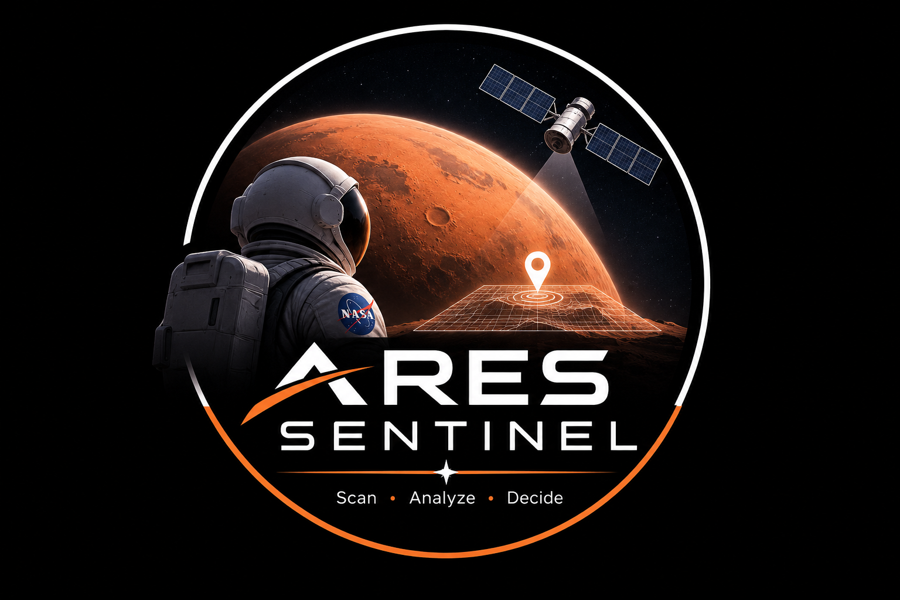

<p align="center"></p>
<h1 align="center">Ares Sentinel</h1>
<p align="center">Intelligence opérationnelle martienne · données NASA, machine learning et Google Gemini</p>

[Projet déployé](https://ares-sentinel.onrender.com)

## Objectif

Ares Sentinel rend les observations REMS du rover Curiosity au cratère Gale réellement explorables : indice pédagogique, détection d’anomalies, historique, sélection par sol ou date terrestre et profil visuel de chaque sol. L’indice n’est pas un seuil de sécurité NASA.

L’assistant scientifique utilise **uniquement Google Gemini**. Gemini doit appeler les outils locaux avant de répondre, afin de s’appuyer sur les données réelles. Il n’y a ni modèle local, ni mécanisme de secours local : une clé manquante, un quota ou une erreur Gemini reste visible dans l’interface et dans l’API.

## Lancer localement

```bash
cd backend
uv sync --dev
# créer backend/.env avec GEMINI_API_KEY=votre_cle_google_ai_studio
uv run uvicorn app.main:app --reload
```

Ouvre ensuite http://127.0.0.1:8000. `GEMINI_MODEL` est optionnel (par défaut : `gemini-2.5-flash`). `/api/sante` donne l’état de Gemini.

## Données et visualisation

- `data/curiosity_rems.csv` est une copie locale des observations NASA Curiosity REMS, pas un flux direct.
- Isolation Forest détecte les sols atypiques.
- Le tableau de bord sélectionne un sol précis ou la mesure disponible la plus proche d’une date terrestre.
- La visualisation avancée associe la courbe complète de l’indice et un profil normalisé température/pression/risque pour le sol choisi.

## Technologies

FastAPI, pandas, scikit-learn, Leaflet, JavaScript natif, Google Gemini et Render.
