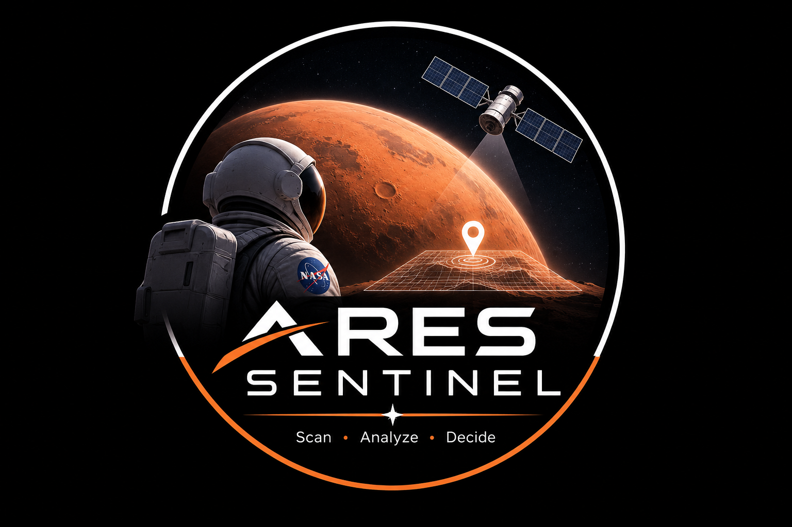
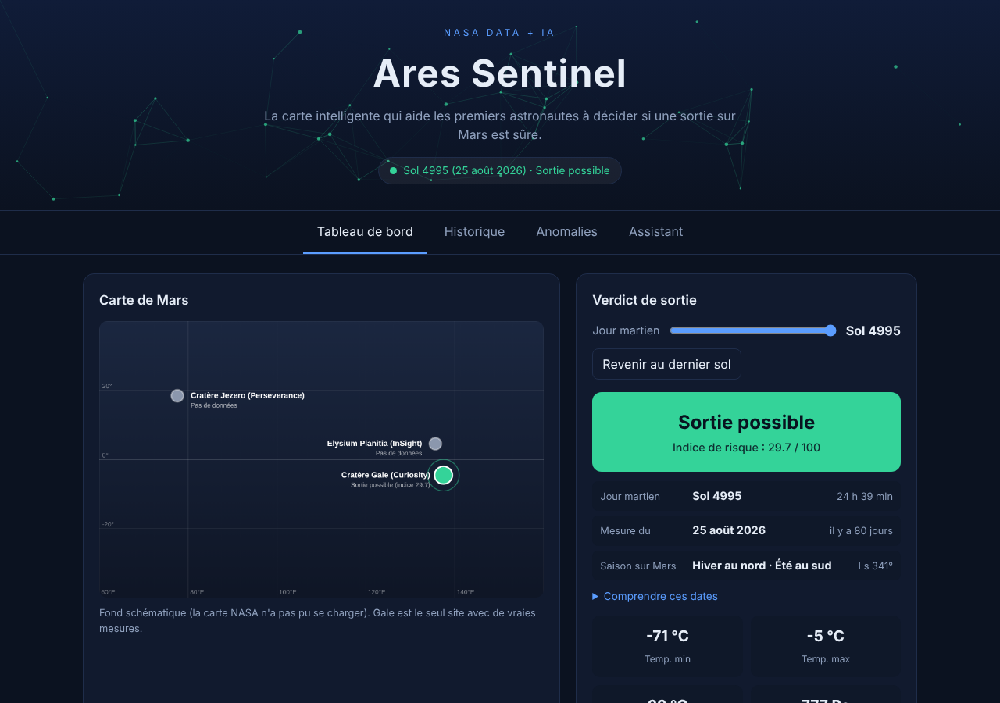
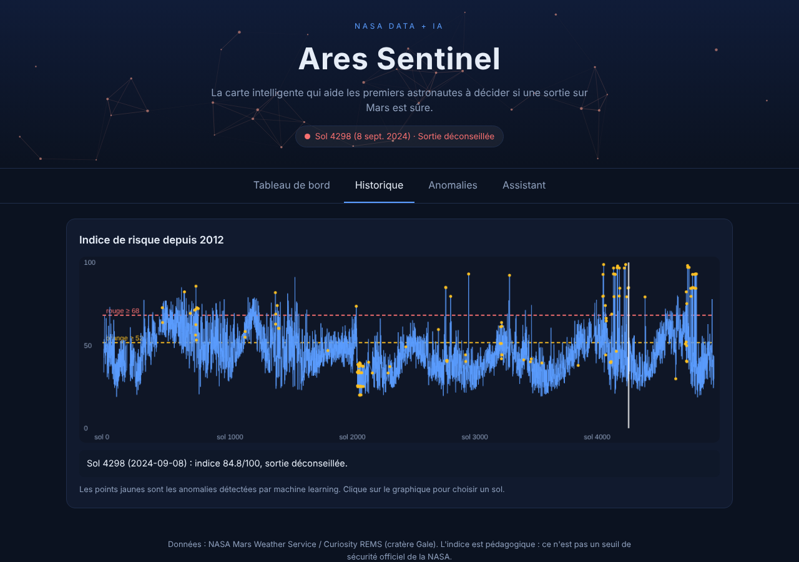
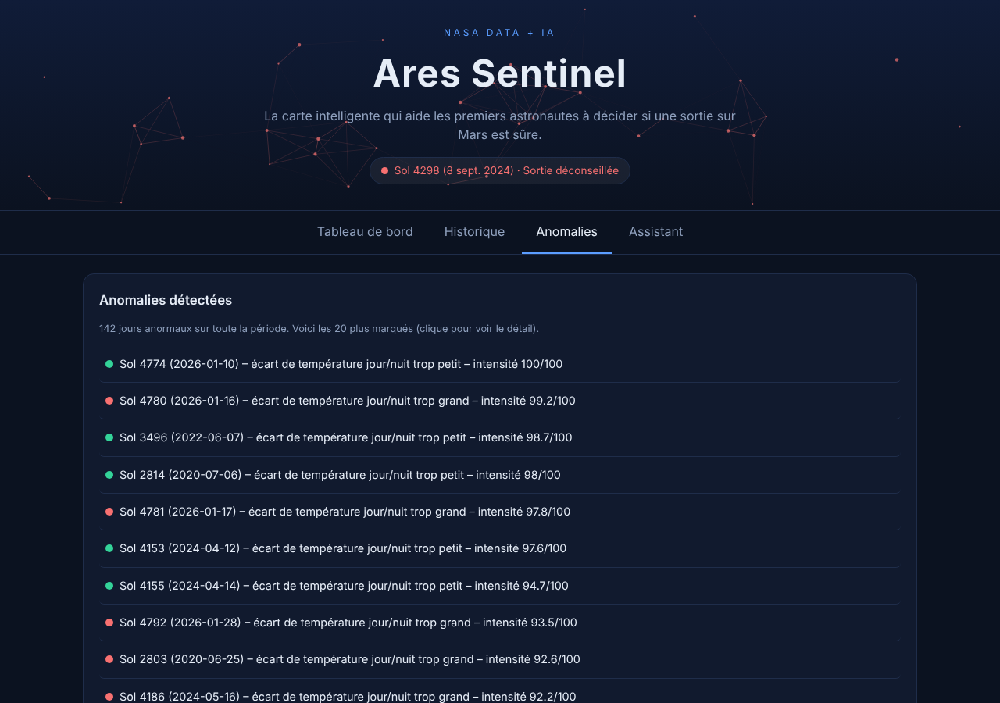
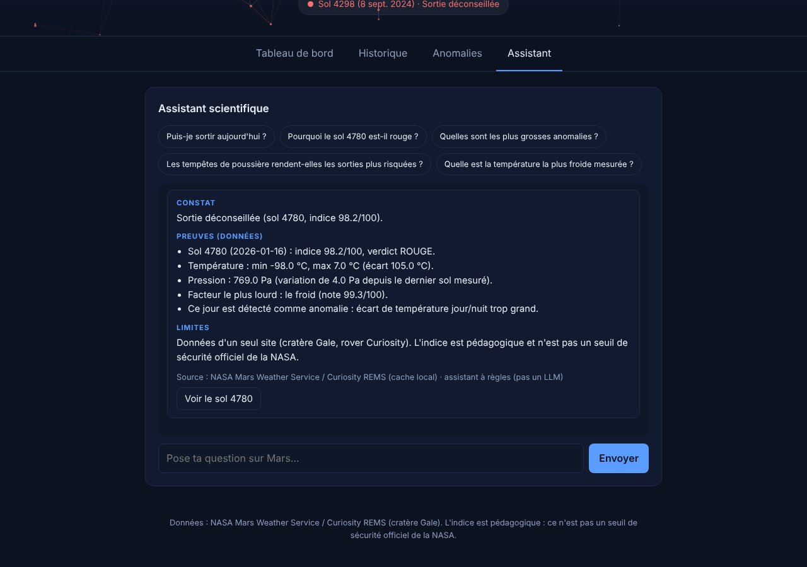
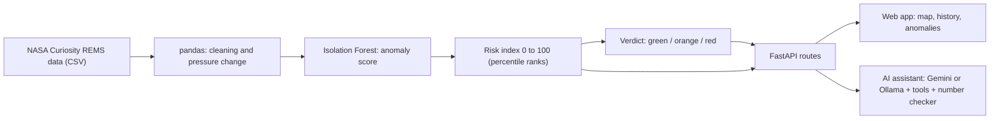

<p align="center"></p>
<h1 align="center">Ares Sentinel</h1>
<p align="center">NASA Space App Challenge</p>

**The smart map that helps the first astronauts decide whether a walk outside on Mars is safe.**

An analysis platform built on **NASA data + AI** for Mars exploration: an interactive map with real NASA imagery, machine-learning anomaly detection, and an AI science assistant that never invents a number.
Explore Curiosity REMS data from Gale Crater through a sol/date selector, Mars map, risk timeline, anomaly detection, and an AI data assistant. The score is educational and is not a NASA safety threshold.

    

     

     

  

     


> *Ares* is the Greek name of the god associated with Mars. *Sentinel* is a lookout that watches and raises the alarm. Together: a guardian watching over the first explorers of Mars.

> ⚠️ **Educational project.** created as part of the NASA Space Apps Challenge. See [Limitations](#-limitations-and-honesty).

---

## 🎬 Demo

| | |
|---|---|
| 🌐 **Live demo** | https://ares-sentinel.onrender.com |
| 💻 **Source code** | https://github.com/sefimiakanda/ares-sentinel |

### Screenshots

**Dashboard**: map, verdict, dates and the four factors behind the decision


**History**: the risk index for every Martian day since 2012 (yellow dots = anomalies found by machine learning)


**Anomalies**: the days the model finds unusual, with the reason


**AI assistant**: answers as *Finding → Evidence → Limits*, using only real data



### Photos and NASA links to see the real thing
- 🛰️ Curiosity's weather station (REMS) on its mast: https://science.nasa.gov/resource/mars-weather-station-tools-on-rovers-mast/
- 📈 Seasonal temperature, humidity and pressure cycles measured by Curiosity: https://science.nasa.gov/photojournal/seasonal-cycles-in-curiositys-first-two-martian-years/
- 🇪🇸 The REMS team (Centro de Astrobiología, Spain): https://cab.inta-csic.es/en/proyectos/msl-rems/
- 🗺️ NASA Mars Trek (the map imagery used here): https://trek.nasa.gov/mars/
- 🌍 The Viking global mosaic of Mars (USGS): https://astrogeology.usgs.gov/search/map/mars_viking_colorized_global_mosaic_232m
- 🚀 Curiosity mission page: https://science.nasa.gov/mission/msl-curiosity/

---

## 📑 Table of contents

1. [The problem](#-the-problem)
2. [What Ares Sentinel does](#-what-ares-sentinel-does)
3. [Mars explained simply](#-mars-explained-simply)
4. [The Curiosity rover and the 2012 landing](#-the-curiosity-rover-and-the-2012-landing)
5. [The data](#-the-data)
6. [How it works](#-how-it-works)
7. [Project structure and API](#-project-structure-and-api)
8. [Getting started](#-getting-started)
9. [Deploying on Render](#-deploying-on-render)
10. [Security: keeping secrets out of GitHub](#-security-keeping-secrets-out-of-github)
11. [Limitations and honesty](#-limitations-and-honesty)
12. [Roadmap](#-roadmap)
13. [Credits](#-credits)

---

## 🎯 The problem

Mars is not a place where you simply step outside. Before an astronaut leaves the base, someone has to answer one question: **"Is today riskier than usual?"** NASA has years of weather data from the Curiosity rover, but raw numbers (temperatures in degrees, pressure in pascals, angles on an orbit) are hard to turn into a quick decision.

Ares Sentinel turns those numbers into a traffic light, and, most importantly, **explains why**.

## ✨ What Ares Sentinel does

| Feature | What it gives you |
|---|---|
| 🗺️ **Interactive map** | Real imagery of Mars from NASA Mars Trek (zoom and pan), with the three landing sites colored by verdict. A drawn fallback map appears if the imagery cannot load. |
| 🚦 **Verdict for any Martian day** | 🟢 Possible · 🟠 Caution · 🔴 Not recommended, from a risk index between 0 and 100, with a slider to travel through 14 years of data. |
| 🔍 **Explained decision** | The four factors (cold, day/night swing, pressure change, unusual day) shown as bars, each with its weight. |
| 🤖 **Anomaly detection** | A machine-learning model (Isolation Forest) flags ~3 % of days as unusual, and says which measurement is responsible. |
| 💬 **AI science assistant** | Answers in French as *Finding → Evidence → Limits*, **only from real data**, through tools. A checker flags any number that does not come from the data. Works with Google Gemini (online) or Ollama (local), with an automatic fallback. |
| 📅 **Clear dates** | Martian day (sol), Earth date, how old the measurement is, and the Martian season in plain words. |

---

## 🪐 Mars explained simply

### Mars at a glance

| | Mars | Earth |
|---|---|---|
| Diameter | about 6,800 km | about 12,700 km (twice as big) |
| Gravity | 3.7 m/s² (**38 %** of ours) | 9.8 m/s² |
| One day | **24 h 39 min** (called a *sol*) | 24 h |
| One year | **687 Earth days** | 365 days |
| Axis tilt | 25° | 23° |
| Distance from the Sun | about 1.5 times Earth's | 1 |
| Air | **95 % carbon dioxide** | 78 % nitrogen, 21 % oxygen |
| Surface air pressure | **about 600 Pa on average** (0.6 % of Earth's) | 101,325 Pa |
| Average temperature | about −63 °C | about +15 °C |
| Global magnetic field | none | yes |

### The sol: a Martian day
Mars spins a little slower than Earth. One Martian day, a **sol**, lasts 24 hours 39 minutes. Mission teams count days in sols: **sol 0 is the day Curiosity landed** (6 August 2012). In this project, "sol 4995" means the 4,995th Martian day of the mission.

### Seasons, and what "Ls" means
Mars is tilted like Earth, so it has **seasons**. But its year lasts 687 days, so each season is about twice as long as ours. Two more differences:

- **Seasons are opposite in the two hemispheres** (winter in the north = summer in the south), exactly like on Earth.
- Mars' orbit is **more stretched** than Earth's. When Mars is closer to the Sun it moves faster, so seasons have **unequal lengths**, and the southern summer is hotter and shorter than the northern one.

Scientists describe the position of Mars on its orbit with **Ls** (*solar longitude*), an angle from 0° to 360°:

| Ls | Northern hemisphere | Southern hemisphere |
|---|---|---|
| **0°** | Start of spring | Start of autumn |
| **90°** | Start of summer | Start of winter |
| **180°** | Start of autumn | Start of spring |
| **270°** | Start of winter | Start of summer |

Mars is closest to the Sun (perihelion) around Ls 250°, and farthest (aphelion) around Ls 70°. For example, on the last day of the dataset (sol 4995), Ls was about 341°: **end of winter in the north, end of summer in the south**.

### Temperature: why is it so cold, and why such big swings?
On Earth, a thick atmosphere acts like a blanket: it stores the Sun's heat and releases it slowly at night. Mars has almost no blanket. The air is extremely thin and dry, so:

1. **It is cold on average**: Mars is farther from the Sun and receives less light.
2. **Heat escapes immediately after sunset**: nothing holds it.
3. **Day and night are very different**: in our data, the gap between the coldest and warmest moment of the same day is **62 °C on average**, and sometimes more than 100 °C.

What the Curiosity data (Gale Crater) shows:

| Measure | Value in our dataset |
|---|---|
| Average daily minimum | **−74.6 °C** (−102 °F) |
| Average daily maximum | **−12.2 °C** (10 °F) |
| Coldest minimum | **−100 °C** (−148 °F) |
| Warmest maximum | **+11 °C** |

So even the "warm" part of a Martian day is below freezing most of the time. For comparison, the coldest winter nights in Antarctica are around −60 to −80 °C.

> 🧊 **Why it matters for an astronaut:** a spacesuit must protect against extreme cold *and* against large temperature swings within a single walk (materials expand and contract, batteries lose power in the cold). In Ares Sentinel, the **cold** factor counts for 35 % of the risk index.

### Pressure: an atmosphere 120 times thinner than ours
Air pressure is the weight of the column of air above you. On Mars, the average pressure at Gale Crater in our data is **about 817 Pa**: roughly **124 times lower than on Earth** (101,325 Pa). Some consequences:

- **A human could not survive outside without a pressurized suit.** Below about 6,300 Pa (the *Armstrong limit*), the water in your body would start to boil at body temperature. Mars is far below this limit.
- **Liquid water cannot stay at the surface.** At 817 Pa, water boils at only about **4 °C**; otherwise it freezes or evaporates.
- **Winds feel weak.** Even a 100 km/h wind pushes with very little force, because the air is so thin. Dust storms are impressive to look at but would not knock you over like in the movies.

The pressure also **changes with the seasons**: in Martian winter, a large part of the carbon dioxide in the air (roughly a quarter) freezes onto the polar caps, so pressure drops. In summer it evaporates and pressure rises again. On top of that, pressure changes **from day to day**, a sign of passing weather systems, vortices or dust storms. This is why Ares Sentinel looks at the **change in pressure between two days**: a sudden change means unsettled weather. In our data, the pressure ranges from **679 to 925 Pa**.

### Dust and dust storms
Mars is covered with very fine dust. In the southern spring and summer (Ls roughly 180° to 360°), the heat of the Sun lifts it, and **regional dust storms** are common; every few years some grow into **global storms** that cover the whole planet for weeks. In 2018, a global storm hid the Sun so much that NASA's solar-powered Opportunity rover lost power and went silent. Curiosity, powered by a **nuclear battery**, kept working.

Dust also changes the temperature: it absorbs sunlight, so the **days cool down** while the **nights stay warmer**, and the day/night swing shrinks. That is why, in our data, the dust season does **not** simply look "worse": the result is mixed (a smaller swing, but more days with unstable pressure).

For astronauts, dust is a threat for another reason: it is **sharp, sticky and electrostatic**. It clogs joints, coats solar panels and sticks to suits.

### What Ares Sentinel does *not* measure
Radiation, wind and humidity are real dangers on Mars, but they are **not part of this project's index**:

- **Radiation:** Mars has no global magnetic field and a very thin atmosphere, so cosmic and solar radiation reaches the surface more strongly than on Earth. Curiosity carries an instrument for it (RAD), but we do not use it.
- **Wind and humidity:** Curiosity's weather station measures them too (the wind sensor was damaged early in the mission), and they are not used here either.

The assistant is built to say "I don't have that data" instead of guessing.

---

## 🚀 The Curiosity rover and the 2012 landing

**Curiosity** (mission name *Mars Science Laboratory*, MSL) is a NASA rover the size of a small car: about **899 kg**, six wheels, a robotic arm, a laser to analyze rocks, and **10 scientific instruments**. It is powered by a **radioisotope generator** (heat from plutonium turned into electricity), so it keeps working through the night, the winter and the dust storms.

Its mission: find out whether Mars ever had an environment **habitable for microbial life**. It does not look for life itself; it looks for the ingredients.

### Key dates
| Date | Event |
|---|---|
| **26 Nov 2011** | Launch from Cape Canaveral on an Atlas V rocket |
| **6 Aug 2012, 05:17 UTC** | **Landing** in Gale Crater (sol 0) |
| 22 Aug 2012 | The landing site is named *Bradbury Landing* (after the writer Ray Bradbury, on what would have been his 92nd birthday) |
| 2013 | First major result: an ancient freshwater lake environment that could have supported microbes (Yellowknife Bay) |
| Today | Still climbing Mount Sharp, more than 14 years later: the mission was planned for about two years |

### Why Gale Crater?
Gale is a crater **154 km wide** (about 3.5 to 3.8 billion years old) with a mountain in its center, **Mount Sharp**, about 5 km high. Its **layers** are like pages of a history book: each layer records the environment of its time (clay, sulfates, signs of water). Climbing the mountain means reading the climate history of Mars.

### "Seven minutes of terror": the landing
The signal from Mars needed **13.8 minutes** to reach Earth. So when engineers heard "entry started", the rover was **already dead or alive**, and nobody could do anything. Everything had to run by itself, in about **7 minutes**, from **21,000 km/h to zero**:

1. **Guided entry.** Two tungsten weights (150 kg in total) were thrown away so the capsule could "steer" slightly through the air and aim precisely.
2. **Heat shield.** The friction with the atmosphere makes the front of the capsule extremely hot. The heat shield protects the rover and starts to slow it down.
3. **Supersonic parachute.** A giant parachute opens and slows the capsule further.
4. **Heat shield released, radar on.** The radar measures the distance to the ground.
5. **Powered descent.** The rover and its rocket-powered "descent stage" separate from the parachute. **Eight rocket engines** fire to stop the fall.
6. **The sky crane.** This is the famous trick. The rocket stage **hovers** about 20 m above the ground and **lowers the rover on three nylon cables** (about 7.5 m long), like a crane hanging from the sky. Why not rockets directly on the ground? It would blow dust everywhere and could damage the rover.
7. **Touchdown.** Wheels first, slower than a walking pace. The cables are cut, and the rocket stage **flies away to crash a safe distance from the rover**.

**76 pyrotechnic devices** had to work perfectly, in order. All of them did. The relay satellite *Mars Odyssey* passed the news to Earth: *"Touchdown confirmed. We're safe on Mars."* The sky crane was used again in 2021 to land the Perseverance rover.

### The weather station: REMS
Curiosity carries a weather station called **REMS** (*Rover Environmental Monitoring Station*), provided by **Spain** (Centro de Astrobiología) with sensors from **Finland**. It measures air temperature, ground temperature, pressure, humidity, wind and ultraviolet light, several times per hour. **These are the measurements Ares Sentinel uses** (temperature and pressure).

---

## 📊 The data

- **Source:** NASA Mars Weather Service, built from the REMS instrument on Curiosity (Gale Crater).
- **File:** `data/curiosity_rems.csv`, **4,745 Martian days** from August 2012 to **25 August 2026** (sol 4995).
- **Important:** this is a **saved copy**, not a live feed. "Today" in the app means "the last day of this copy". To get more recent days, update the file with the script below.
- **Update the data:** from `backend/`, run `uv run python scripts/update_data.py` (add `--dry-run` to preview). It downloads NASA's public Mars Weather Service JSON feed (`https://mars.nasa.gov/rss/api/?feed=weather&category=msl&feedtype=json`), merges new Martian days into the CSV, rejects invalid dates and impossible values, keeps a `.bak` backup, and **never touches the file if the download fails**. This is an unofficial feed that NASA may change or stop; if it does not answer, open the address in your browser, save it as `flux.json` and run `uv run python scripts/update_data.py --input flux.json`. The official archive is the NASA PDS Atmospheres Node: https://atmos.nmsu.edu/data_and_services/atmospheres_data/MARS/curiosity/rems.html (heavier files, not handled by the script). Then restart the server (and, on Render, commit and push `data/curiosity_rems.csv`).
- **Missing values:** some days have no measurement. Rule of the project: **no measurement, no verdict** (28 days are marked "unknown"). A missing value is never replaced by an invented one.

| Column | Meaning |
|---|---|
| `sol` | Martian day number (0 = landing day) |
| `terrestrial_date` | Date on Earth |
| `solar_longitude_ls` | Position of Mars on its orbit (the season), 0° to 360° |
| `martian_season` | Season label, computed by the project from Ls (one label per quarter of the orbit; not a NASA field) |
| `air_temp_min_c`, `air_temp_max_c` | Coldest and warmest air temperature of the day (°C) |
| `temp_amplitude_c` | Difference between the two |
| `pressure_pa` | Air pressure in pascals |

---

## ⚙️ How it works



### 1. Anomaly detection (machine learning)
**Isolation Forest** (scikit-learn). Imagine isolating each Martian day in a room by placing walls at random. A **normal** day looks like thousands of others: you need many walls to isolate it. A **strange** day is alone in its corner: it is isolated quickly. The faster a day is isolated, the more anomalous it is.

The model looks at 4 measurements at once (minimum temperature, maximum temperature, daily swing, pressure) and flags **about 3 %** of the days (142 anomalies). For each one we also say **why**, by finding the measurement furthest from the median (a robust z-score).

> An anomaly is an **unusual** day, not necessarily a **dangerous** one.

### 2. The risk index (0 = easy day, 100 = very hard day)
For each day, four scores from 0 to 100. Each score is a **rank**: *"this day is harder than X % of all days observed"*.

```
index = 0.35 × cold + 0.25 × day/night swing + 0.20 × pressure change + 0.20 × unusual day
```

The verdict depends on where the index falls in the history:

| Verdict | Meaning | Index threshold (current data) |
|---|---|---|
| 🟢 **Green** | among the 70 % easiest days | below about 51.7 |
| 🟠 **Orange** | between 70 % and 95 % | 51.7 to 68.1 |
| 🔴 **Red** | among the 5 % hardest days ever measured | above about 68.1 |

**Why ranks and not fixed thresholds?** The first attempt used fixed thresholds and 98 % of the days came out "orange": useless, because Mars is *always* very cold. Comparing a day with the other days finally separates the good days from the bad ones. Result: about 3,300 green days, 1,200 orange, 240 red.

### 3. The AI assistant, and why it cannot make up numbers
A language model (LLM) can invent figures. Here, the LLM **knows no data about Mars**. When it needs a number, it must call a **tool**: a Python function that reads our real data.

1. The user asks a question.
2. The LLM decides to call a tool, e.g. `obtenir_sortie(sol=4780)`.
3. Our code reads the data and returns the result.
4. The LLM writes its answer **from that result only**: *Finding → Evidence → Limits*.
5. A **number checker** compares every figure in the answer with the tool results and shows a ⚠️ for any figure that was not found.

Four tools: `obtenir_sortie`, `lister_anomalies`, `comparer_saisons`, `statistiques_globales`.

| Mode | When | Notes |
|---|---|---|
| **Gemini** (Google AI Studio) | if `GEMINI_API_KEY` exists | free quotas, works online (Render) |
| **Ollama** (local) | otherwise, if Ollama is running | free, private, runs on your computer |
| **Rule-based assistant** | otherwise, or if the LLM fails or ignores the tools | always available, answers from the data with keyword rules |

The page tells you which mode is active and why. The app never crashes because an LLM is missing.

### 4. The map
Leaflet and the NASA **Mars Trek** tiles (Viking MDIM 2.1 global mosaic). If the imagery or Leaflet cannot load, a drawn map takes over automatically. Only Gale Crater has a verdict; Elysium Planitia and Jezero Crater show "no data" instead of invented values.

---

## 🗂️ Project structure and API

```
ares-sentinel/
├── README.md  /  README.fr.md
├── render.yaml                  # Render deployment (Blueprint)
├── .gitignore                   # keeps .env (secrets) out of GitHub
├── data/curiosity_rems.csv      # NASA data (copy)
├── docs/screenshots/            # images used in this README
├── backend/                     # Python + FastAPI
│   ├── pyproject.toml           # dependencies (managed by uv)
│   ├── uv.lock
│   ├── .env.example             # template for your secrets (the real .env is NOT on GitHub)
│   ├── app/
│   │   ├── main.py              # API routes
│   │   ├── pipeline.py          # CSV -> anomalies -> index -> verdict
│   │   ├── indice.py            # risk index and verdict
│   │   ├── anomalies.py         # Isolation Forest
│   │   ├── outils.py            # the 4 tools the LLM can call
│   │   ├── llm.py               # Gemini / Ollama, tool loop, number checker
│   │   ├── assistant.py         # picks LLM or fallback, rule-based assistant
│   │   ├── config.py            # reads backend/.env
│   │   └── sites.py             # the 3 sites on the map
│   └── tests/
└── frontend/                    # HTML + CSS + JavaScript (no framework)
    ├── index.html  style.css  app.js
    └── plexus.js                # animated network effect in the header
```

| Route | Purpose |
|---|---|
| `GET /api/sante` | Server status and active assistant (Gemini, Ollama or rules) |
| `GET /api/carte?sol=` | Sites and their verdict |
| `GET /api/sortie/{sol}` | Detailed verdict for one Martian day |
| `GET /api/serie` | Index of all days (history chart) |
| `GET /api/anomalies?limite=` | Most unusual days |
| `POST /api/assistant` | Ask the assistant a question |
| `GET /docs` | Automatic API documentation (FastAPI) |

---

## 🚀 Getting started

You need [uv](https://docs.astral.sh/uv/getting-started/installation/) (it installs Python for you) and Git.

```bash
git clone https://github.com/YOUR-USERNAME/ares-sentinel.git
cd ares-sentinel/backend
uv sync                                   # creates .venv and installs everything
uv run uvicorn app.main:app --reload      # starts the server
```

Open **http://127.0.0.1:8000**. Run the tests with `uv run pytest`.

### Enable the AI assistant (optional)
**Option A: Gemini (free quotas, also works online)**
1. Create a key at https://aistudio.google.com/apikey
2. In `backend/`, copy `.env.example` to `.env` and set `GEMINI_API_KEY=your_key`
3. **Restart** the server (`--reload` does not watch `.env`). `/api/sante` should show `"assistant":"gemini"`.

**Option B: Ollama (local and free)**
```bash
# install Ollama from https://ollama.com/download, then:
ollama pull qwen2.5:7b
```
Restart the server. `/api/sante` should show `"assistant":"ollama"`.

| Variable | Role | Default |
|---|---|---|
| `GEMINI_API_KEY` | Google AI Studio key (**secret**) | none |
| `GEMINI_MODEL` | Gemini model | `gemini-2.5-flash` |
| `LLM_PROVIDER` | force `gemini` or `ollama` | automatic |
| `OLLAMA_MODEL` | Ollama model | `qwen2.5:7b` |
| `OLLAMA_HOST` | Ollama address | `http://localhost:11434` |

---

## ☁️ Deploying on Render

The repo contains a ready-to-use **`render.yaml`** (a Blueprint).

1. Push the project to GitHub (with `backend/uv.lock`, `data/` and `frontend/`).
2. On https://render.com: **New +** → **Blueprint** → select your repository → **Apply**.
3. Render asks for the secret `GEMINI_API_KEY`: paste your key there (optional; without it the assistant uses its fallback).
4. Wait for the build. Open the URL; `/api/sante` must answer `"statut":"OK"`.

Every `git push` on `main` redeploys automatically.

**Python version:** Render runs Python 3.12 (set in `render.yaml`). Make sure `backend/pyproject.toml` says `requires-python = ">=3.12"` and that no `.python-version` file asks for something newer. `uv init` writes the version of *your* computer's Python (for example 3.14), which makes the build fail with `No interpreter found for Python >=3.14`. After changing it, run `uv lock` in `backend/` and commit `pyproject.toml` and `uv.lock`.

**Good to know (free plan):** the service goes to sleep after a while without visits (the first visit then takes about a minute: open the site before a demo); memory is limited, so check *Metrics* if the build or the app runs out of memory; Ollama cannot run on Render, so use Gemini online.

---

## 🔐 Security: keeping secrets out of GitHub

- Your key lives **only** in `backend/.env` (local) or in Render's environment variables (online).
- `.gitignore` contains `.env`, `.env.*` and `!.env.example`, so only the key-free template is published.
- Check before every push: `git status` must **not** list `.env` (`git check-ignore -v backend/.env` shows the rule that ignores it).
- If a key was ever pushed or shared, **revoke it immediately** and create a new one: it stays in the Git history.

---

## ⚠️ Limitations and honesty

- **Not a NASA product** and **not suitable for real mission decisions.**
- **One site with real data** (Gale Crater). Other sites show "no data".
- The index is **educational** and **relative to Curiosity's own history**. A "green" day on Mars is still extremely harsh.
- **Radiation, wind and dust** are not measured directly; dust is represented only by the season.
- **The data is a saved copy**, not live: "today" means "the last day of the file".
- An "anomaly" is an unusual day, not always a dangerous one.
- An LLM can still misphrase an answer. The checker verifies **numbers**, not the meaning of sentences: read the *Evidence* section and the list of tools used.

---

## 🗺️ Roadmap

1. Live data update script (pull the latest sols from NASA).
2. Perseverance (MEDA) data to give Jezero Crater a real verdict.
3. A real **3D globe** of Mars.
4. Predict tomorrow's index and compare it with a simple "same as today" baseline.
5. Conversation memory and streaming answers for the assistant.

---

## 🙏 Credits

- **NASA/JPL-Caltech**: Curiosity rover, Mars Weather Service data, **Mars Trek**.
- **Centro de Astrobiología (CSIC-INTA, Spain)** and the **Finnish Meteorological Institute**: the REMS weather station.
- **USGS Astrogeology Science Center**: Viking MDIM 2.1 global mosaic.
- Built for the **NASA Space Apps Challenge**. Not affiliated with or endorsed by NASA.
- Tools: FastAPI, pandas, scikit-learn, Leaflet, uv, Ollama, Google Gemini, Render.

## License

Released under the MIT License – see [LICENSE](LICENSE).
